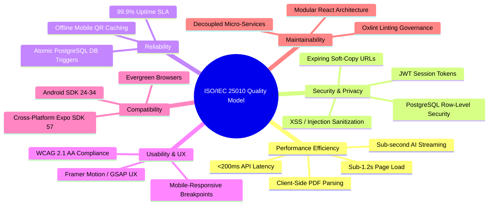

# E-Kodak: Non-Functional Requirements Specification (NFRS)
## Standardized under ISO/IEC 25010 Software Product Quality Model

## 1. Introduction & Quality Model Architecture

Non-Functional Requirements (NFRs) specify the systemic criteria, operational constraints, and quality attributes used to judge the performance, reliability, security, and scalability of the **E-Kodak Photography Service Management System**.

The pre-defense proposal merely listed generic items ("Desktop", "Mobile Phone", "PHP", "Firebase", "Antivirus"). This document replaces that deficient list with an enterprise-grade specification grounded in the **ISO/IEC 25010 System and Software Quality Model**, complemented by verified hardware and software architectural specifications.

---

## 2. ISO/IEC 25010 Quality Characteristics

### 2.1 Performance Efficiency
* **NFR-PERF-01 (Page Load Time):** Initial First Contentful Paint (FCP) shall occur within **1.2 seconds** and Largest Contentful Paint (LCP) within **2.0 seconds** over standard 4G/broadband connections, achieved through Vite bundle optimization, code-splitting, and asset preloading.
* **NFR-PERF-02 (API Response Latency):** Supabase REST queries and PostgreSQL stored procedures shall return data payloads within **200 milliseconds** for 95% of requests under nominal load.
* **NFR-PERF-03 (Generative AI Latency):** Studio AI Concierge responses shall initiate streaming within **800 milliseconds** using Groq's high-speed inference engine, or within **1.8 seconds** using Google Gemini 2.5 Flash fallback.
* **NFR-PERF-04 (Client-Side PDF Parsing):** The institutional school masterlist parser (`pdfMasterlistScannerService.js`) shall extract and cluster tabular records for up to 250 students in less than **3.0 seconds** purely within the client's web browser, consuming less than 120MB of browser heap memory.
* **NFR-PERF-05 (Mathematical Optimization):** The Python OR-Tools solver (`optimizer/solver.py`) shall compute optimal photographer reschedule allocations across a 28-day window within **1.5 seconds**.

### 2.2 Security & Data Privacy
* **NFR-SEC-01 (Database Row-Level Security):** Every table in the PostgreSQL database shall enforce Row-Level Security (RLS) policies. Direct row access shall be strictly partitioned by `auth.uid()` and verified user roles (`customer`, `admin`, `photographer`, `staff`), preventing unauthorized cross-tenant data leaks.
* **NFR-SEC-02 (Authentication & Session Tokens):** Authentication shall use cryptographic JSON Web Tokens (JWT) signed by Supabase Auth with automated token refresh cycles and secure cookie storage.
* **NFR-SEC-03 (Input Sanitization & Injection Defense):** All incoming client payloads (text fields, academic notes, phone numbers) must pass through `securityValidator.js` to strip script tags, SQL injection fragments, and unescaped HTML characters before database insertion.
* **NFR-SEC-04 (File Upload Restrictions):** Uploads to Supabase Storage buckets (`reference-images`, `photo-outputs`) shall enforce strict MIME-type whitelisting (`image/jpeg`, `image/png`, `image/webp`, `application/pdf`) and maximum file size caps (10MB for customer reference images, 25MB for photographer deliverables).
* **NFR-SEC-05 (Digital Asset Protection):** High-resolution photo deliverables and soft copies stored in the digital vault shall be served via authenticated, time-limited expiring URLs (e.g., 60-minute TTL) to prevent permanent public hotlinking.

### 2.3 Compatibility & Interoperability
* **NFR-COMP-01 (Cross-Browser Compatibility):** The web application shall render identically and without script degradation across modern evergreen browsers: Google Chrome (v110+), Mozilla Firefox (v110+), Apple Safari (v16+), and Microsoft Edge (v110+).
* **NFR-COMP-02 (Mobile Platform Interoperability):** The mobile companion application shall support Android devices running **Android 7.0 (API Level 24) through Android 14+ (API Level 34)**, and iOS devices running iOS 15+.
* **NFR-COMP-03 (Payment Gateway Interoperability):** The system shall integrate seamlessly with digital payment notification standards (GCash, Maya, Bank Transfer, and Xendit payment APIs).

### 2.4 Usability & User Experience (UX)
* **NFR-USA-01 (Responsive Design Breakpoints):** The user interface shall adapt dynamically across three primary viewport classes: Mobile (<640px), Tablet (640px - 1024px), and Desktop (>1024px) utilizing Tailwind CSS utility classes.
* **NFR-USA-02 (Micro-Interactions & Feedback):** Every user action (booking confirmation, status change, photo upload, payment submission) shall provide immediate visual feedback within **100 milliseconds** via interactive state toasts, loading spinners, or Framer Motion transitions.
* **NFR-USA-03 (Accessibility Compliance):** The web portals shall adhere to **WCAG 2.1 Level AA** guidelines, ensuring accessible color contrast ratios (minimum 4.5:1 for normal text), keyboard navigable modal dialogs, and ARIA attributes for screen readers.

### 2.5 Reliability & Fault Tolerance
* **NFR-REL-01 (System Availability):** The production cloud deployment (Supabase and Vercel/Netlify infrastructure) shall maintain a minimum of **99.9% uptime SLA**, excluding scheduled maintenance windows.
* **NFR-REL-02 (Data Consistency & Atomic Triggers):** Financial balances, down payment calculations, and booking status transitions shall be computed atomically within PostgreSQL triggers (`trg_update_booking_balance`). If any payment insert fails, the transaction rolls back completely to prevent ledger desynchronization.
* **NFR-REL-03 (Offline QR Pass Availability):** The mobile companion application shall cache client QR passes locally within encrypted device storage (`Expo Secure Store`), allowing customers to display their studio check-in passes even in the event of studio network loss.

### 2.6 Maintainability & Modularity
* **NFR-MAINT-01 (Modular Component Architecture):** Code shall follow strict separation of concerns into `/components` (UI elements), `/services` (business logic and API wrappers), `/hooks` (state hooks), and `/lib` (utilities).
* **NFR-MAINT-02 (Static Code Analysis & Linting):** All JavaScript and JSX code shall compile with zero syntax warnings and zero linting violations under **Oxlint** before deployment.
* **NFR-MAINT-03 (Decoupled Micro-Services):** Computationally intensive tasks (such as mathematical optimization) shall reside in an isolated FastAPI service (`/optimizer`), ensuring heavy constraint solving does not block the primary user-facing web server.

---

## 3. Hardware Requirements Matrix

| Deployment Tier | Minimum Hardware Specifications | Recommended Production Specifications | Role in E-Kodak System |
|---|---|---|---|
| **Cloud Hosting (Supabase & Web)** | Serverless compute, 1 vCPU, 1GB RAM (Edge instances) | Scalable Multi-Zone Cloud Compute (AWS/GCP via Supabase & Vercel), Automated Daily Backups | Hosts PostgreSQL database, Storage buckets, Edge Functions, and CDN static assets. |
| **Optimization Micro-Service Server** | 1 vCPU, 1GB RAM, Python 3.11+ | 2 vCPU, 2GB RAM, Python 3.14 (Docker container) | Executes Google OR-Tools CP-SAT mathematical optimization solver. |
| **Studio Front-Desk Workstation** | Dual-core CPU @ 2.0 GHz, 4GB RAM, 1080p display | Quad-core CPU @ 2.5 GHz+, 8GB RAM, Full HD Display, Web Camera | Used by studio front-desk staff for booking management and in-camera QR code check-in. |
| **Photographer Workstation / Field Laptop** | Quad-core CPU, 8GB RAM, SSD storage | 6-core+ CPU, 16GB RAM, Dedicated GPU, Fast NVMe SSD | Used for studio editing, high-resolution photo export, and batch output uploading. |
| **Client / Mobile Devices** | Smartphone with 2GB RAM, Android 7.0+ or iOS 15+, 720p screen, rear camera | Smartphone with 4GB+ RAM, Android 11+ or iOS 16+, 1080p screen, autofocus camera | Used by studio clients for browsing packages, booking sessions, viewing QR passes, and tracking status. |

---

## 4. Software Requirements & Technology Stack Matrix

The table below contrasts the actual, production-verified software stack against the flawed pre-defense suggestions:

| Software Layer | Pre-Defense Proposed Item | Actual Production Stack | Version | Purpose & Architecture Justification |
|---|---|---|---|---|
| **Frontend Framework** | Generic HTML/CSS/JS | **React** | `v19.2.8` | Declarative UI, reactive state management, high-performance virtual DOM diffing. |
| **Build & Tooling** | None specified | **Vite** | `v8.2.2` | Lightning-fast Hot Module Replacement (HMR) and optimized Rollup tree-shaking bundles. |
| **CSS Utility Engine** | Cascading Style Sheets (CSS) | **Tailwind CSS** | `v3.4.19` | Utility-first responsive design tokens, zero runtime CSS overhead. |
| **Cross-Platform Mobile** | React Native & .NET MAUI | **React Native + Expo SDK** | `SDK 57 (RN 0.86)` | Unified cross-platform mobile codebase; access to Camera, SecureStore, and Push Notifications. |
| **Native Android Build** | .NET MAUI | **Kotlin Android** | `SDK 34 (Android 14)` | Native Gradle compilation (`EkodakAndroid`), ProGuard optimization, and native performance. |
| **Database & Auth** | Firebase & PHP | **Supabase (PostgreSQL)** | `PostgreSQL 15+` | ACID relational compliance, foreign keys, Row-Level Security (RLS), and Realtime WebSocket subscriptions. |
| **AI Inference Engine** | None | **Google Gemini API** (`@google/genai`) | `v2.18.0` | 24/7 intelligent studio assistant, conversational inquiries, and contextual scheduling advice. |
| **High-Speed LLM Fallback** | None | **Groq Cloud API** | `Qwen 3.8 / Llama` | Sub-second streaming chat completions to eliminate user wait times. |
| **Mathematical Solver** | None | **Google OR-Tools** (CP-SAT) | `Python 3.14 / FastAPI` | Solves complex discrete constraint satisfaction problems for conflict-free shoot schedules. |
| **PDF & OCR Parsing** | None | **pdfjs-dist** | `v6.5.438` | Spatial Y-coordinate table clustering for extracting student masterlists directly in the browser. |
| **Document Generation** | Office Suite | **jsPDF, docx, jszip** | `jsPDF 4.2, docx 9.1` | Client-side export of formatted masterlist sheets, Word rosters, and yearbook proofs without MS Office. |
| **QR Code Processing** | Generic library | **jsQR & qrcode.react** | `jsQR 1.4, qrcode 4.2` | High-density 2D matrix token generation and native video stream QR decoding. |
| **Data Visualization** | Analytical Tools API | **Recharts** | `v3.10.1` | SVG-based responsive analytics for studio revenue trends and package distribution. |
| **Code Linter** | None | **Oxlint** | `v1.79.0` | Ultra-fast Rust-based static code analysis enforcing modern ES standards. |

---

## 5. Explicit Stack Corrections: Retiring Phantom Pre-Defense Tech

1. **Retirement of Hypertext Processor (PHP):** PHP was completely eliminated. The serverless architecture utilizes Supabase PostgreSQL Edge Functions (TypeScript/Deno) and Python FastAPI, providing non-blocking asynchronous event handling.
2. **Retirement of .NET MAUI:** .NET MAUI required heavy C# tooling and had poor code-sharing with the web client. It was completely replaced with React Native (Expo SDK 57), which shares JavaScript models, authentication state, and API contracts directly with the web application.
3. **Retirement of Firebase:** Firebase's NoSQL Firestore lacked native relational joins, complex foreign key constraints, and declarative SQL triggers necessary for studio booking balances, status histories, and academic rosters. Supabase PostgreSQL provided full SQL relational power with native RLS.
4. **Retirement of Antivirus & Office Suite:** Antivirus and MS Office were erroneously listed in the pre-defense proposal. In the real system, document generation is handled programmatically via `docx` and `jsPDF`, and antivirus protection is managed at the OS/cloud firewall layer, not inside the software source code.

