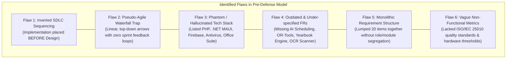

# E-Kodak SDLC Model & Requirements: Pre-Defense vs. Implemented System Gap Analysis

## Executive Summary

During the pre-defense and initial planning stages of the **E-Kodak** Capstone Project, the development team submitted a conceptual diagram representing the intended Software Development Life Cycle (SDLC), system modules, functional requirements (FR), and non-functional requirements (NFR). 

Following multiple Agile sprint cycles and full-scale system implementation, significant deviations, architectural evolutions, and methodology corrections occurred. This document provides a rigorous, defense-ready critique of the original conceptual figure, details the fundamental flaws present in the initial draft, and presents an itemized side-by-side gap analysis comparing the pre-defense expectations against the final, production-deployed system.

---

## 1. Critique & Flaw Analysis of the Pre-Defense Diagram

An examination of the pre-defense figure reveals six (6) fundamental methodology, architectural, and engineering flaws:

### Flaw 1: Inverted SDLC Sequencing (Implementation Preceding Design)
* **Pre-Defense Issue:** In the original diagram, the left-hand process column flows sequentially from `PLANNING` downwards directly to `IMPLEMENTATION`, which then points down to `DESIGN`, which then points to `TESTING`.
* **Engineering Critique:** In software engineering principles and Agile frameworks alike, coding before designing UI/UX prototypes, database schemas, and API contracts is an anti-pattern known as "code-and-fix." Implementing before designing leads to massive technical debt, database rework, and architectural instability.
* **Resolution:** The sequence has been corrected to the standard, iterative software lifecycle: **Planning → Design & Architecture → Sprint Implementation → Testing & QA → Incremental Deployment**, bounded within cyclical sprint increments.

### Flaw 2: Pseudo-Agile Linear Waterfall Disguise
* **Pre-Defense Issue:** The proposal claimed to adopt a "Lightweight Agile Development Model," yet the visual model depicted a rigid, top-down Waterfall progression with unidirectional arrows and zero feedback loops.
* **Engineering Critique:** Agile is defined by the *Agile Manifesto* and Scrum framework as iterative, incremental, and empirical. True Agile incorporates Sprint Planning, Daily Syncs, Sprint Execution, Sprint Reviews, and Retrospectives, producing a releasable Product Increment every 1 to 2 weeks. The original figure lacked Sprint Backlogs, iterative review milestones, or continuous feedback mechanisms.
* **Resolution:** The updated diagram introduces cyclical Agile sprint feedback loops that interconnect Implementation, Testing, Stakeholder Review, and Backlog Refinement.

### Flaw 3: Phantom & Hallucinated Technology Stack
* **Pre-Defense Issue:** Under "Non-Functional Requirements (Software)," the figure listed:
  - `Hypertext Processor (PHP)`
  - `.NET MAUI`
  - `Firebase`
  - `Antivirus`
  - `Office Suite`
* **Engineering Critique:** 
  1. **PHP:** Not a single line of PHP exists in the codebase. The entire application runs on modern JavaScript/TypeScript (React 19, Vite, Node/Deno) and Python.
  2. **.NET MAUI:** No C# or .NET MAUI framework was utilized. Cross-platform mobile was built using **React Native (Expo SDK 57)** and a native **Kotlin Android (SDK 34)** build.
  3. **Firebase:** The database, authentication, real-time channels, storage, and row-level access control were built natively on **Supabase (PostgreSQL 15+)**, not Google Firebase.
  4. **Antivirus & Office Suite:** Antivirus software and Microsoft Office are desktop productivity utilities; they are not software dependencies, libraries, or architectural requirements of a web/mobile photography management system. Listing them demonstrates an academic misunderstanding of software NFR categories.
* **Resolution:** The software requirements have been updated to reflect the true, production-verified stack: React 19, Vite, Tailwind CSS, Supabase (PostgreSQL 15, Auth, Storage, Edge Functions, RLS), Google Gemini 2.5 API, Python 3.14 + FastAPI + Google OR-Tools CP-SAT Solver, and Expo / React Native.

### Flaw 4: Outdated and Under-Specified Functional Requirements
* **Pre-Defense Issue:** The pre-defense list only captured 20 rudimentary features (e.g., "Login", "Register", "Manage User", "Logout", "View Yearbook"), reflecting an early, naive perception of a simple CRUD website.
* **Engineering Critique:** As real-world client requirements from photography studios were gathered, the system required enterprise-grade capabilities that were completely omitted from the pre-defense figure:
  - Google Gemini Generative AI Concierge and AI-driven smart rescheduling.
  - Python Google OR-Tools CP-SAT mathematical optimization for photographer assignment.
  - Full-scale Academic Pre-Press Yearbook Publishing Suite (with 5 editorial themes, foil stamping, 2x2 portrait cuts, and print preflight audits).
  - Spatial Y-coordinate PDF Masterlist Scanner and OCR parser for institutional graduation packages.
  - 10-stage real-time booking tracking state machine (`PENDING` through `COMPLETED`).
  - Workstation cross-departmental handoffs (`ORDER_HANDOFF`, `ISSUE_ESCALATION`, `OUTPUT_SUBMISSION`).
  - Row-Level Security (RLS) policies enforcing multi-role data privacy at the database engine level.
* **Resolution:** The updated model formalizes 45+ comprehensive functional requirements across 7 distinct operational modules.

### Flaw 5: Monolithic, Role-Agnostic Requirement Lumping
* **Pre-Defense Issue:** All functional requirements were presented in a single, unstructured 20-bullet column, failing to differentiate between Customer, Admin, Photographer, and Automated Background processes.
* **Engineering Critique:** In enterprise and capstone architecture, requirements must be partitioned by User Persona (Role-Based Access Control) to establish authorization boundaries and test criteria.
* **Resolution:** Functional requirements are categorized into clear functional modules: Client Portal, Studio Operations & Admin Command Center, Photographer Field Suite, Academic Yearbook & Masterlist Engine, AI & Optimization Services, and Mobile Companion.

### Flaw 6: Unmeasured Quality Attributes in Non-Functional Requirements
* **Pre-Defense Issue:** Non-functional requirements only listed generic device names ("Desktop", "Mobile Phone") and software tools without quantifiable metrics.
* **Engineering Critique:** Industry standards (IEEE 830, ISO/IEC 25010) mandate that NFRs must define quality characteristics such as Performance Efficiency (latency, throughput), Security (encryption, RLS), Reliability (fault tolerance), and Usability (WCAG, responsive design).
* **Resolution:** NFRs have been restructured according to the **ISO/IEC 25010 Software Product Quality Model**.

---

## 2. Side-by-Side Comparison: Pre-Defense vs. Current Implemented System

| Feature / Category | Pre-Defense Planning Stage (Photo) | Current Implemented System (Codebase) | Justification & Reason for Change |
|---|---|---|---|
| **Development Lifecycle** | Disordered linear waterfall (Planning → Implementation → Design → Testing → Deployment) | Lightweight Agile Framework (Iterative Sprint Planning, UI/UX Design, Sprint Implementation, ISO 25010 Testing, CI/CD Deployment) | Prevents coding without schema/UX specifications; incorporates continuous client feedback. |
| **Backend & Database** | Firebase / PostgreSQL / PHP | **Supabase (PostgreSQL 15+)** with native Row Level Security (RLS), Triggers, & Edge Functions | Supabase combines enterprise PostgreSQL relational integrity with realtime subscriptions, eliminating PHP server overhead. |
| **Frontend Web Stack** | HTML / CSS / JavaScript (Generic) | **React 19 + Vite 8 + Tailwind CSS 3.4 + Framer Motion 13 + Lucide Icons** | Component-driven reactivity, ultra-fast Hot Module Replacement (HMR), and hardware-accelerated animations. |
| **Mobile Architecture** | React Native & .NET MAUI | **React Native (Expo SDK 57)** with Native **Kotlin Android** integration | .NET MAUI was dropped in favor of Expo SDK 57 for rapid cross-platform mobile delivery and native hardware API access (Camera, Secure Store). |
| **Scheduling Engine** | Manual calendar assignment | **Hybrid AI (Google Gemini 2.5) + Mathematical Constraint Solver (Python FastAPI + Google OR-Tools CP-SAT)** | Manual scheduling caused conflicts and photographer over-allocation; OR-Tools computes optimal conflict-free slots mathematically. |
| **AI Capabilities** | None planned | **Google Gemini Generative AI Assistant & Groq High-Speed LLM** (`src/lib/ai.js`) | Delivers 24/7 intelligent package recommendations, contextual client guidance, and conversational rescheduling. |
| **Yearbook Generation** | "Manage Yearbook and Insert Photos" (Basic viewer) | **Pre-Press Academic Yearbook Studio** (5 Themes, 2x2 Roll Cut, Cover Foil Stamping, Completeness Audit, Flipbook & Print Export) | Commercial photo studios generate high revenue from school graduations; requires complete pre-press prep. |
| **Masterlist Ingestion** | Manual text typing | **Automated PDF / OCR Masterlist Scanner** (`pdfMasterlistScannerService.js`) with spatial coordinate clustering and regex extraction | Manual entry of hundreds of graduating students caused errors; automated OCR parser imports entire class rosters in seconds. |
| **QR Code Verification** | Generic QR code generation | **Encrypted JWT / Tokenized QR Pass** with Client Digital Wallet & Staff In-Camera Scanning Modal | Tamper-proof digital check-in passes that front-desk staff can scan instantly via web camera or mobile app. |
| **Tracking Pipeline** | Simple status flag | **10-Stage Deterministic Workflow State Machine** (`PENDING` → `CONFIRMED` → `PHOTOGRAPHER_ASSIGNED` → `CAPTURE` → `EDITING` → `PRINTING` → `READY` → `COMPLETED`) | Mirrors physical photo studio operations and lab production checkpoints with database CHECK constraints. |
| **Inter-Department Comms** | Unspecified | **Cross-Departmental Workstation Hub** (`workstation_transfers` table with `ORDER_HANDOFF`, `ISSUE_ESCALATION`, etc.) | Eliminates miscommunication between front-desk staff, darkroom editors, photographers, and accounting. |
| **Financial Ledger** | Basic payment status | **Dual-Ledger Atomic Balance Engine** with automated PostgreSQL triggers (`trg_update_booking_balance`) and multi-gateway support | Prevents race conditions and manual math errors when calculating down payments, partial payments, and remaining balances. |

---

## 3. Defense Panel Anticipated Questions & Answers (Q&A)

### Q1: "Why did your technology stack change from PHP, Firebase, and .NET MAUI to React, Supabase, and Expo?"
> **Answer:** "During Sprint 0 of our Agile lifecycle, we conducted architectural trade-off evaluations. PHP was discarded in favor of modern JavaScript/TypeScript (React 19) to achieve a unified full-stack language ecosystem and eliminate context-switching. Firebase was superseded by Supabase because our studio domain required complex relational schema modeling—such as multi-tier booking packages, audit trails, and financial transactions—which are inherently relational and benefit from PostgreSQL's ACID compliance, foreign key constraints, and declarative Row-Level Security (RLS). Lastly, .NET MAUI was consolidated into React Native (Expo SDK 57) because Expo enabled shared logic between the web portal and mobile companion, dramatically accelerating delivery within our lightweight Agile sprints."

### Q2: "In your original diagram, Implementation was shown before Design. How did you handle this in practice?"
> **Answer:** "The pre-defense figure contained a typographical and layout sequencing error that placed implementation above design. In actual practice, we adhered strictly to Agile engineering principles: each feature sprint began with UI/UX prototyping (using Tailwind design tokens and interactive component mocks) and database schema migrations *before* modular full-stack coding commenced. The corrected Agile model now accurately reflects this industry-standard sequence."

### Q3: "How does your system satisfy the 'Lightweight Agile' model?"
> **Answer:** "Our implementation adapted Scrum's lightweight framework: we worked in bi-weekly sprints focusing on working software increments. We prioritized the Minimum Viable Product (MVP) core booking pipeline in Sprint 1, iterated through administrative and photographer operational tools in Sprints 2 and 3, introduced advanced AI and mathematical optimization in Sprint 4, and finalized academic yearbook publishing in Sprint 5. Continuous integration (via Vite and automated linters) and continuous user feedback drove every refinement cycle."

---

## 4. Conclusion

The transition from the pre-defense conceptual diagram to the final implemented system represents a significant maturation of the project. The codebase reflects a robust, scalable, and secure enterprise-grade architecture that far exceeds the initial basic CRUD vision while adhering faithfully to authentic Agile principles.

