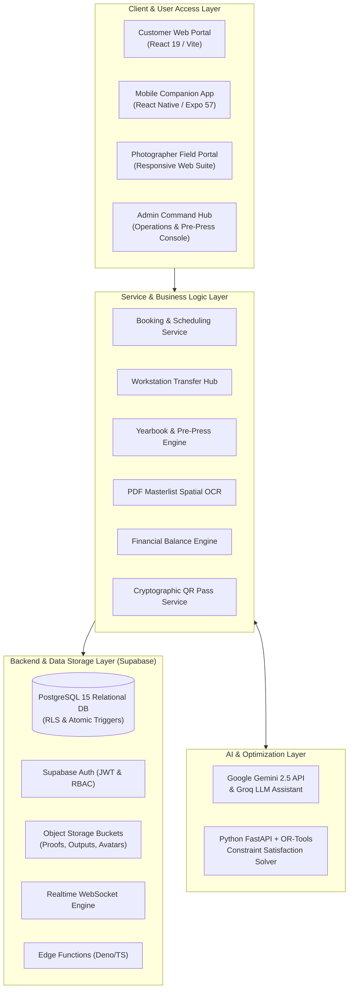

# E-Kodak: System Modules Catalog & Architectural Inventory

## 1. System Architecture Overview

The **E-Kodak Photography Service Management System** is architected as a decoupled, multi-portal enterprise platform. It serves three distinct user groups—**Clients/Customers**, **Studio Photographers**, and **Studio Staff/Administrators**—supported by background micro-services for Generative AI and mathematical optimization.

---

## 2. Inventory of System Modules

### Module 1: Public Showcase & Marketing Portal
* **Purpose:** Serves prospective clients, displaying studio packages, portfolio galleries, client reviews, FAQ accordions, and studio announcements.
* **Routes & Pages:**
  - `/` — [Home.jsx](file:///d:/E-kodak%20Final/src/pages/Home.jsx): Hero banner, studio value propositions, featured packages preview, mobile app promo.
  - `/about` — [About.jsx](file:///d:/E-kodak%20Final/src/pages/About.jsx): Studio history, mission, and team member showcase.
  - `/services` — [Services.jsx](file:///d:/E-kodak%20Final/src/pages/Services.jsx): Interactive package finder, service tiers, package inclusions, and price calculators.
  - `/gallery` — [Gallery.jsx](file:///d:/E-kodak%20Final/src/pages/Gallery.jsx): Filterable visual showcase (Portrait, Graduation, Event, Wedding, Family).
  - `/contact` — [Contact.jsx](file:///d:/E-kodak%20Final/src/pages/Contact.jsx): Studio location map, inquiry form, and operating hours.
  - `/legal` — [Legal.jsx](file:///d:/E-kodak%20Final/src/pages/Legal.jsx): Terms of Service and Privacy Policy.
  - `/pass/:token` — [PublicPassPage.jsx](file:///d:/E-kodak%20Final/src/pages/PublicPassPage.jsx): Shareable public digital pass for check-in verification.

### Module 2: Customer Self-Service Dashboard (`/dashboard/*`)
* **Purpose:** Private portal for registered clients to book sessions, monitor shoot progress, submit payments, download retouched deliverables, and review audit trails.
* **Routes & Pages:**
  - `/dashboard` — [DashboardHome.jsx](file:///d:/E-kodak%20Final/src/pages/dashboard/DashboardHome.jsx): Quick summary of active bookings, recent activity, and notifications.
  - `/dashboard/book` — [BookSessionPage.jsx](file:///d:/E-kodak%20Final/src/pages/dashboard/BookSessionPage.jsx): 4-step wizard with Cebu school selector, package tier picker, and reference image uploader.
  - `/dashboard/bookings/:id` — [BookingDetailsPage.jsx](file:///d:/E-kodak%20Final/src/pages/dashboard/BookingDetailsPage.jsx): Complete session brief, photographer details, invoice breakdown, and reschedule requests.
  - `/dashboard/bookings/:id/progress` — [BookingProgressPage.jsx](file:///d:/E-kodak%20Final/src/pages/dashboard/BookingProgressPage.jsx): 10-stage milestone timeline tracking live photo production.
  - `/dashboard/soft-copies` — [SoftCopiesPage.jsx](file:///d:/E-kodak%20Final/src/pages/dashboard/SoftCopiesPage.jsx): Digital vault displaying proofs and downloadable retouched high-res photos.
  - `/dashboard/payments` — [PaymentsPage.jsx](file:///d:/E-kodak%20Final/src/pages/dashboard/PaymentsPage.jsx): Payment ledger, GCash/Maya reference submission, down payment status, and balances.
  - `/dashboard/activity` — [ActivityTrailPage.jsx](file:///d:/E-kodak%20Final/src/pages/dashboard/ActivityTrailPage.jsx): Personal audit log of bookings, status updates, and transactions.
  - `/dashboard/notifications` — [NotificationsPage.jsx](file:///d:/E-kodak%20Final/src/pages/dashboard/NotificationsPage.jsx): In-app alert inbox with unread counter.
  - `/dashboard/profile` — [ProfilePage.jsx](file:///d:/E-kodak%20Final/src/pages/dashboard/ProfilePage.jsx): Avatar upload, contact info, and personal address management.
  - `/dashboard/settings` — [SettingsPage.jsx](file:///d:/E-kodak%20Final/src/pages/dashboard/SettingsPage.jsx): Security settings, password change, and notification preferences.

### Module 3: Admin Operations Command Center (`/admin/*`)
* **Purpose:** Comprehensive studio enterprise management system for receptionists, managers, darkroom lab supervisors, and studio owners.
* **Routes & Pages:**
  - `/admin/dashboard` — [AdminDashboard.jsx](file:///d:/E-kodak%20Final/src/pages/admin/AdminDashboard.jsx): Real-time KPI cards, Studio Revenue Trend Chart (Recharts), Package Share Chart, and Live Booking Calendar.
  - `/admin/bookings` — [AdminBookings.jsx](file:///d:/E-kodak%20Final/src/pages/admin/AdminBookings.jsx): Master booking queue with status filtering, multi-sort, soft-deletes, and quick status advances.
  - `/admin/bookings/:id` — [AdminBookingDetail.jsx](file:///d:/E-kodak%20Final/src/pages/admin/AdminBookingDetail.jsx): Deep booking inspector, photographer assigner with conflict detection, and status logs.
  - `/admin/scanner` — [StaffQRScannerModal.jsx](file:///d:/E-kodak%20Final/src/components/admin/StaffQRScannerModal.jsx): Camera-driven front-desk scanner for instant customer check-in.
  - `/admin/photographers` — [AdminPhotographers.jsx](file:///d:/E-kodak%20Final/src/pages/admin/AdminPhotographers.jsx): Staff roster, workload balancer, availability review, and specialization tags.
  - `/admin/payments` — [AdminPayments.jsx](file:///d:/E-kodak%20Final/src/pages/admin/AdminPayments.jsx): Financial verification desk, manual payment recording, balance reconciler, and receipt generator.
  - `/admin/photos` — [AdminPhotos.jsx](file:///d:/E-kodak%20Final/src/pages/admin/AdminPhotos.jsx): Photo output vault manager, quality assurance review, and client release approvals.
  - `/admin/yearbook` — [AdminYearbookGenerator.jsx](file:///d:/E-kodak%20Final/src/pages/admin/AdminYearbookGenerator.jsx): Pre-press academic publishing studio with multi-theme renderer, 2x2 roll cutter, and print book generator.
  - `/admin/services` — [AdminServices.jsx](file:///d:/E-kodak%20Final/src/pages/admin/AdminServices.jsx): Package and tier manager, base pricing, down payment requirements, and add-on CRUD.
  - `/admin/cms` — [AdminCMS.jsx](file:///d:/E-kodak%20Final/src/pages/admin/AdminCMS.jsx): Website content manager (Hero announcements, FAQs, testimonials, gallery portfolio).
  - `/admin/customers` — [AdminCustomers.jsx](file:///d:/E-kodak%20Final/src/pages/admin/AdminCustomers.jsx): Customer directory, booking histories, contact dossiers, and account standing.
  - `/admin/staff` — [AdminStaff.jsx](file:///d:/E-kodak%20Final/src/pages/admin/AdminStaff.jsx): Employee user accounts, role elevation, and activation gate for new personnel.
  - `/admin/activity-logs` — [AdminActivityLogsPage.jsx](file:///d:/E-kodak%20Final/src/pages/admin/AdminActivityLogsPage.jsx): System-wide immutable audit trail of logins, status shifts, and deletions.
  - `/admin/sms-logs` — [AdminSmsLogs.jsx](file:///d:/E-kodak%20Final/src/pages/admin/AdminSmsLogs.jsx): Outbound SMS gateway dispatch logs with delivery status codes.
  - `/admin/security` — [AdminSecurity.jsx](file:///d:/E-kodak%20Final/src/pages/admin/AdminSecurity.jsx): Security policy monitor, RLS policy verification, and active session oversight.
  - `/admin/settings` — [AdminSettings.jsx](file:///d:/E-kodak%20Final/src/pages/admin/AdminSettings.jsx): Global studio settings, business hours, down payment percentages, and notification credentials.

### Module 4: Photographer Field Suite (`/photographer/*`)
* **Purpose:** Mobile-friendly portal engineered specifically for studio shooters and event photographers working on set.
* **Routes & Pages:**
  - `/photographer/dashboard` — [PhotographerDashboard.jsx](file:///d:/E-kodak%20Final/src/pages/photographer/PhotographerDashboard.jsx): Today's assigned photo shoots, quick client contact, and monthly stats.
  - `/photographer/bookings` — [PhotographerBookings.jsx](file:///d:/E-kodak%20Final/src/pages/photographer/PhotographerBookings.jsx): Assigned shoot cards with brief inspection, assignment acceptance, and status advancement (`CAPTURE` → `EDITING` → `PRINTING`).
  - `/photographer/availability` — [PhotographerAvailability.jsx](file:///d:/E-kodak%20Final/src/pages/photographer/PhotographerAvailability.jsx): Interactive availability calendar for blocking out leave, days off, and preferred shift hours.
  - `/photographer/uploads` — [PhotographerUploads.jsx](file:///d:/E-kodak%20Final/src/pages/photographer/PhotographerUploads.jsx): High-resolution deliverable batch uploader with automatic compression and storage bucket routing.
  - `/photographer/activity-logs` — [PhotographerActivityLogs.jsx](file:///d:/E-kodak%20Final/src/pages/photographer/PhotographerActivityLogs.jsx): Personal audit trail of status changes, accepted shoots, and uploaded photos.
  - `/photographer/settings` — [PhotographerSettings.jsx](file:///d:/E-kodak%20Final/src/pages/photographer/PhotographerSettings.jsx): Bio, equipment list, portrait specialization, and personal notification preferences.

### Module 5: Pre-Press Academic Yearbook Studio
* **Components & Services:** [AdminYearbookGenerator.jsx](file:///d:/E-kodak%20Final/src/pages/admin/AdminYearbookGenerator.jsx), [yearbookService.js](file:///d:/E-kodak%20Final/src/services/yearbookService.js).
* **Capabilities:**
  - **5 Pre-Press Themes:** Classic, Modern Editorial, Minimalist, Chalkboard, and Doodle.
  - **Cover & Foil Designer:** [YearbookCoverEditorModal.jsx](file:///d:/E-kodak%20Final/src/components/admin/yearbook/YearbookCoverEditorModal.jsx) — Gold, Silver, and Rose Gold foil stamping simulation with custom embossed school insignias.
  - **2x2 Portrait Cutter Roll:** [TwoByTwoRollModal.jsx](file:///d:/E-kodak%20Final/src/components/admin/yearbook/TwoByTwoRollModal.jsx) — Batch crops and tiles student portraits with student ID stamping.
  - **Completeness Preflight Audit:** [CompletenessAuditDrawer.jsx](file:///d:/E-kodak%20Final/src/components/admin/yearbook/CompletenessAuditDrawer.jsx) — Verifies zero missing student portraits, unlinked names, or omitted mottos before publishing.
  - **Interactive 3D Flipbook:** [YearbookFlipbook.jsx](file:///d:/E-kodak%20Final/src/components/admin/yearbook/YearbookFlipbook.jsx) — Virtual page-turning preview for client review.
  - **Print Book Generator:** [YearbookPrintBook.jsx](file:///d:/E-kodak%20Final/src/components/admin/yearbook/YearbookPrintBook.jsx) — Generates 300 DPI CMYK-compliant print spreads for commercial printing presses.

### Module 6: Institutional School Masterlist Scanner & OCR Engine
* **Components & Services:** [pdfMasterlistScannerService.js](file:///d:/E-kodak%20Final/src/services/pdfMasterlistScannerService.js), [masterlistTemplateService.js](file:///d:/E-kodak%20Final/src/services/masterlistTemplateService.js), [documentConverterService.js](file:///d:/E-kodak%20Final/src/services/documentConverterService.js).
* **Capabilities:**
  - **Spatial Coordinate Clustering:** Reconstructs tabular rows from raw PDF text tokens based on vertical and horizontal Y/X coordinates using `pdfjs-dist`.
  - **Heuristic Regex Parser:** Automatically detects and extracts 10 core graduation requirements: School Name, Strand/Track, Section, Adviser Name, Adviser Email, Adviser Phone, Batch #, Student ID, Complete Student Name (First, Middle, Last), and Package Set.
  - **AI OCR Fallback:** Automatically switches to multimodal LLM parsing (Gemini / Groq) when processing scanned, tilted, or non-standard class rosters.
  - **Automated Masterlist Template Generator:** Generates standardized Word (.docx) and Excel templates for schools.

### Module 7: Studio AI Concierge & OR-Tools Optimization Engine
* **Components & Services:** [AIAssistant.jsx](file:///d:/E-kodak%20Final/src/components/ai/AIAssistant.jsx), [ai.js](file:///d:/E-kodak%20Final/src/lib/ai.js), [optimizer/main.py](file:///d:/E-kodak%20Final/optimizer/main.py), [optimizer/solver.py](file:///d:/E-kodak%20Final/optimizer/solver.py).
* **Capabilities:**
  - **Studio AI Concierge:** 24/7 conversational assistant using Google Gemini 2.5 API with studio persona, guiding users on outfit guidelines, packages, and booking policies.
  - **High-Speed Groq Engine:** Sub-second streaming fallback engine for instant chat responses.
  - **OR-Tools Reschedule Solver:** Python FastAPI microservice utilizing Google OR-Tools CP-SAT constraint solver to compute mathematically optimal, conflict-free reschedule dates and balance photographer workloads.

### Module 8: Cross-Platform Mobile Companion (Expo SDK 57 / React Native)
* **Application Location:** `d:\E-kodak Final\mobile` & `d:\E-kodak Final\EkodakAndroid`
* **Screens & Components:**
  - [HomeScreen.jsx](file:///d:/E-kodak%20Final/mobile/src/screens/HomeScreen.jsx): Studio home, active booking card, and quick action buttons.
  - [BookingTrackerScreen.jsx](file:///d:/E-kodak%20Final/mobile/src/screens/BookingTrackerScreen.jsx): Mobile milestone progress stepper with animated mascot feedback.
  - [QRScannerScreen.jsx](file:///d:/E-kodak%20Final/mobile/src/screens/QRScannerScreen.jsx): Native camera QR scanner for instant studio front-desk check-in.
  - [SavedBookingsScreen.jsx](file:///d:/E-kodak%20Final/mobile/src/screens/SavedBookingsScreen.jsx): Local offline wallet caching encrypted booking passes.
  - [PhotographerScheduleScreen.jsx](file:///d:/E-kodak%20Final/mobile/src/screens/PhotographerScheduleScreen.jsx): Photographer mobile agenda with shoot briefs and directions.
  - [WalkingFoxMascot.jsx](file:///d:/E-kodak%20Final/mobile/src/components/WalkingFoxMascot.jsx): Interactive animated studio guide providing photoshoot tips.

