# E-Kodak: Extreme Programming (XP) Methodology & System Architecture

## Executive Summary

Following departmental directives, the **E-Kodak Photography Service Management System** engineering lifecycle is structured according to the **Extreme Programming (XP) Model**, an agile software development discipline engineered for high responsiveness to changing customer requirements, continuous feedback, and rapid delivery of production-grade software increments.

This document formally captures all system processes, architectural designs, functional and non-functional requirements, and validation standards established within the codebase.

---

## 1. Visual Model: Extreme Programming (XP) Framework

```mermaid
flowchart TD
    subgraph XPFramework["Extreme Programming (XP) Model — E-Kodak"]
        direction TB
        
        PLAN["<b>Planning</b><br/>Project Context | Purpose &amp; Description | Objective"]
        
        subgraph ANALYSIS["<b>Analysis</b>"]
            direction LR
            FR["<b>Functional Requirements (Process-Sequential)</b><br/>1. Register<br/>2. Login with Role-Based Access<br/>3. View Service Packages &amp; Pricing<br/>4. View Portfolio Gallery<br/>5. Ask AI Assistant for Inquiries<br/>6. Track Booking via Public Pass<br/>7. Book Photo Session<br/>8. Select Date &amp; Time Schedule<br/>9. Review Booking Summary<br/>10. Submit Downpayment &amp; Billing<br/>11. Generate Booking QR Pass<br/>12. View Booking Details &amp; Dossier<br/>13. Track Photo Production Status<br/>14. View &amp; Download Soft Copies<br/>15. Cancel or Reschedule Booking<br/>16. Scan QR Code in Mobile App<br/>17. Track Milestones on Mobile<br/>18. Save Bookings for Offline Access<br/>19. Manage Photographer Availability<br/>20. View Assigned Shoot Roster<br/>21. Upload Photo Deliverables<br/>22. Upload School Masterlist<br/>23. Scan &amp; Parse Masterlist<br/>24. Manage School Masterlists<br/>25. Manage Yearbook Projects<br/>26. Manage Yearbook Page Layouts<br/>27. Batch Upload Yearbook Portraits<br/>28. View Yearbook Flipbook<br/>29. Export Yearbook (PDF/Print)<br/>30. View Analytical Dashboard<br/>31. Manage Bookings &amp; Assignments<br/>32. Manage Customer Directory<br/>33. Verify Payments &amp; Record Treasury<br/>34. Manage Services &amp; Add-Ons<br/>35. Manage Studio Settings &amp; CMS<br/>36. Logout"]
            
            NFR["<b>Non- Functional Requirements</b><br/><b>Hardware:</b><br/>• PC / Laptop<br/>• Mobile Smartphone<br/><br/><b>Software:</b><br/>• Operating System<br/>• React.js<br/>• Tailwind CSS<br/>• JavaScript<br/>• Vite<br/>• React Native / Expo<br/>• Supabase (PostgreSQL)<br/>• Netlify<br/>• Python (FastAPI / OR-Tools)<br/>• Google Gemini API<br/>• pdfjs-dist / jsPDF / docx"]
        end
        
        subgraph DESIGN["<b>Design &amp; Development</b>"]
            direction LR
            D1["<b>Data Monitoring</b><br/>• Hierarchical Input-Process-Output<br/>• Database Design<br/>• Diagrams"]
            D2["<b>UX &amp; UI Design</b><br/>• Initial System Layout and UI Wireframes<br/>• User Flow<br/>• Responsive Layout Tokens"]
            D3["<b>Dashboard</b><br/>• Role-Specific Dashboard for Customer, Admin, and Photographer"]
            D4["<b>Data Storage &amp; Management</b><br/>• Supabase (PostgreSQL) Relational Schema<br/>• Database Table Normalization<br/>• CRUD Operations"]
            D5["<b>Data Security &amp; Privacy</b><br/>• Authentication<br/>• Data Protection &amp; RLS Policies<br/>• Password Policy<br/>• Input Sanitization"]
            D6["<b>Documentation</b><br/>• User Manual<br/>• Survey Questionnaire<br/>• System Ops Guide"]
        end
        
        subgraph IMPLEMENT["<b>Implementation</b>"]
            direction LR
            I_TECH["<b>Technical Build &amp; Integration</b><br/>• Set up the Supabase (PostgreSQL) database defined in the design stage<br/>• Develop the web application using React.js and Vite<br/>• Build cross-platform mobile companion using React Native and Expo SDK 57<br/>• Build role-based access and dashboards for all users<br/>• Build and test each module"]
            I_XP["<b>XP Core Values &amp; Evaluation</b><br/>• Communication<br/>• Simplification<br/>• Feedback<br/>• Deploy the system on Vercel<br/>• Testing the system's performance using ISO 25010 standards and user acceptance using UTAUT"]
        end
        
        SYS["<b>System</b><br/>• Develop and evaluate the web-based and cross-platform photography studio management system (E-KODAK) for managing student records, booking appointments, photo tracking, graduation yearbook applications, and studio operations."]
        
        PLAN --> ANALYSIS
        ANALYSIS --> DESIGN
        DESIGN --> IMPLEMENT
        IMPLEMENT -->|System Output| SYS
        SYS -.->|Continuous Iterative XP Feedback Loop| ANALYSIS
    end
```



---

## 2. Planning

### 2.1 Project Context
Commercial photography studios in the Philippines, particularly those catering to high-volume senior high school and collegiate graduation packages (such as E-Kodak Studio in Naga, Cebu), operate in an environment subject to heavy seasonal bottlenecks. During peak academic graduation months, studios manage hundreds of student shoots, multiple institutional sections, package selections, and balance collections.

Traditional studio operations rely heavily on physical paper forms, fragmented social media direct messages, unsynchronized spreadsheets, and manual telephone inquiries. This leads to common industry failures: double-booked studio slots, unassigned photographers, lost customer pose references, mathematical billing discrepancies, and extreme delays in academic yearbook assembly.

### 2.2 Purpose & Description
**E-Kodak** is an integrated, cross-platform photography service management and client engagement system. Built with **React 19**, **Vite**, **Tailwind CSS**, **Supabase (PostgreSQL 15+)**, and **React Native (Expo SDK 57)**, the platform replaces disjointed manual processes with a synchronized, role-based ecosystem connecting **Customers**, **Administrators**, and **Photographers**.

The system streamlines the complete studio workflow: from self-service client package selection and schedule booking, to mobile app QR code scanning, 7-stage production tracking, academic yearbook management, document masterlist scanning, and digital soft-copy delivery.

### 2.3 Objective
To design, develop, and evaluate a comprehensive photography studio management platform that:
1. Eliminates scheduling conflicts and double bookings through automated schedule validation.
2. Provides clients and administrators with transparent, real-time tracking across production milestone stages (`Received` through `Ready / Completed`).
3. Streamlines graduation package processing by introducing automated masterlist document scanning and yearbook layout tools.
4. Enforces robust financial integrity through automated database triggers recalculating down payments, installments, and balances.
5. Evaluates software quality and user acceptance using the **ISO/IEC 25010 Software Product Quality Model** and the **Unified Theory of Acceptance and Use of Technology (UTAUT)** framework.

---

## 3. Analysis

### 3.1 Functional Requirements (Process-Sequential)

The functional requirements are ordered strictly according to the end-to-end studio operational lifecycle and mapped directly to existing codebase implementations:

#### Stage 1: Discovery, Inquiry & Onboarding
1. **Register:** Enable new client account registration with academic credentials.
2. **Login with Role-Based Access:** Authenticate users across Customer, Admin, and Photographer roles.
3. **View Service Packages & Pricing:** Display photography services, package tiers, inclusions, and prices.
4. **View Portfolio Gallery:** Browse categorized portfolio photos with an interactive modal preview.
5. **Ask AI Assistant for Inquiries:** Automated assistant answering customer questions about packages and studio policies.
6. **Track Booking via Public Pass:** Enable public status checking using booking reference numbers or QR pass links.

#### Stage 2: Reservation & 7-Step Booking Flow
7. **Book Photo Session:** Multi-step client booking wizard with service selection and school lookup.
8. **Select Date & Time Schedule:** Interactive calendar displaying open studio hours and validated time slots.
9. **Review Booking Summary:** Pre-checkout review of package inclusions, pricing breakdowns, and policies.
10. **Submit Downpayment & Billing:** Client downpayment submission via GCash, Maya, or bank transfer with reference verification.
11. **Generate Booking QR Pass:** Issue digital booking passes with unique QR codes upon reservation completion.

#### Stage 3: Client Dashboard & Production Milestones
12. **View Booking Details & Dossier:** View booking information, studio location maps, and print session vouchers.
13. **Track Photo Production Status:** Real-time 7-stage milestone tracker (`Received` through `Ready`).
14. **View & Download Soft Copies:** Client portal for accessing watermarked proofs and downloading retouched high-resolution photos.
15. **Cancel or Reschedule Booking:** Client workflow to request session date rescheduling or cancellations.

#### Stage 4: Mobile Companion Operations
16. **Scan QR Code in Mobile App:** Scan booking QR codes using the mobile device camera to retrieve session details.
17. **Track Milestones on Mobile:** Interactive mobile progress tracker with animated studio mascot guides.
18. **Save Bookings for Offline Access:** Cache and view session details on mobile devices without an active internet connection.

#### Stage 5: Photographer Operations
19. **Manage Photographer Availability:** Allow photographers to configure working schedules and block off-duty dates.
20. **View Assigned Shoot Roster:** Dedicated photographer roster displaying shoot briefs, dates, and locations.
21. **Upload Photo Deliverables:** Batch photo upload interface for photographers to submit finished photo sets to the studio vault.

#### Stage 6: Institutional Masterlists & Academic Yearbook Processing
22. **Upload School Masterlist:** Ingest school class section rosters in PDF or document formats.
23. **Scan & Parse Masterlist:** Extract student names, IDs, sections, package sets, and mottos from documents.
24. **Manage School Masterlists:** Store, view, and organize institutional section rosters for graduation shoots.
25. **Manage Yearbook Projects:** Create and organize school yearbook publication projects.
26. **Manage Yearbook Page Layouts:** Select and configure yearbook design themes and page spreads.
27. **Batch Upload Yearbook Portraits:** Batch upload and link individual 2x2 graduation portraits to student records.
28. **View Yearbook Flipbook:** Digital interactive 3D preview of compiled yearbook pages before printing.
29. **Export Yearbook (PDF/Print):** Run preflight checks and generate print-ready PDF files for commercial publishing.

#### Stage 7: Administrative Oversight, Treasury & System Operations
30. **View Analytical Dashboard:** Display studio metrics, booking volumes, and real-time revenue summaries.
31. **Manage Bookings & Assignments:** Update booking milestones, manage walk-in orders, and assign photographers.
32. **Manage Customer Directory:** Administrative management of user profiles, academic records, and live portal presence.
33. **Verify Payments & Record Treasury:** Review payment receipts, record in-studio cash transactions, and issue vouchers.
34. **Manage Services & Add-Ons:** Content management for service categories, tiers, inclusions, and add-on pricing.
35. **Manage Studio Settings & CMS:** Configure operating hours, payment QR codes, policies, and landing page announcements.
36. **Logout:** Securely terminate active sessions and clear authentication tokens.

### 3.2 Non- Functional Requirements

#### Hardware
* **PC / Laptop:** Enables administrators and photographers to manage studio bookings, process photos, parse student masterlists, and configure system operations.
* **Mobile Smartphone:** Enables clients and photographers to scan QR codes, monitor production milestones, view schedules, and access digital passes on portable devices.

#### Software
* **Operating System:** Provides the underlying environment to run web browsers, development tools, and mobile applications.
* **React.js:** Powers the modular single-page web user interface with fast component rendering and state management.
* **Tailwind CSS:** Provides responsive layout styling, visual themes, and adaptive screen formatting across devices.
* **JavaScript:** Provides client-side logic, dynamic user interface behavior, and asynchronous communication with backend services.
* **Vite:** Serves as the frontend development server and production build bundler.
* **React Native / Expo:** Powers the cross-platform mobile companion application for Android and iOS devices.
* **Supabase (PostgreSQL):** Provides relational data storage, user authentication, row-level security policies, and photo file storage.
* **Netlify:** Provides automated cloud deployment, global content delivery, and web hosting infrastructure.
* **Python (FastAPI / OR-Tools):** Provides backend optimization services for schedule validation and automated calendar allocation.
* **Google Gemini API:** Provides automated responses to customer inquiries regarding studio packages, schedules, and policies.
* **pdfjs-dist / jsPDF / docx:** Enables client-side extraction of student data from documents and generation of print-ready yearbook PDF files.

---

## 4. Design & Development

```
┌──────────────────────────────────────────────────────────────────────────────────────────────────┐
│                                      DESIGN & DEVELOPMENT                                        │
├──────────────────┬─────────────────┬─────────────────┬─────────────────┬────────────────┬────────┤
│ Data Monitoring  │ UX & UI Design  │    Dashboard    │  Data Storage   │ Data Security  │ Docs   │
├──────────────────┼─────────────────┼─────────────────┼─────────────────┼────────────────┼────────┤
│ • HIPO Diagrams  │ • UI Wireframes │ • Role-Specific │ • PostgreSQL 15 │ • Multi-Role   │ • User │
│ • Relational ERD │ • Responsive    │   Dashboards    │   Relational    │   Auth & JWT   │   Doc  │
│ • Diagrams       │   Tokens        │   (Customer,    │   Schema (3NF)  │ • Row-Level    │ • Admin│
│                  │ • User Flow     │   Admin, and    │ • Table         │   Security RLS │   Guide│
│                  │                 │   Photographer) │   Normalization │ • Input        │ • Survey│
│                  │                 │                 │ • CRUD Ops      │   Sanitization │   Tool │
└──────────────────┴─────────────────┴─────────────────┴─────────────────┴────────────────┴────────┘
```

### 4.1 Data Monitoring
* **Hierarchical Input-Process-Output (HIPO):** Functional decomposition linking inputs (booking requests, payments, uploaded rosters) through business processing services to outputs (booking passes, photo deliverables, yearbook spreads).
* **Database Design:** Normalized relational schema comprising eleven (11) primary entities (`profiles`, `service_categories`, `services`, `add_ons`, `bookings`, `booking_status_history`, `payments`, `photo_outputs`, `workstation_transfers`, `notifications`, `sms_logs`).
* **Diagrams:** System context, architectural, and data flow diagrams illustrating interactions between customer portals, admin dashboards, and database storage.

### 4.2 UX & UI Design
* **Initial System Layout and UI Wireframes:** Design system built on Tailwind CSS tokens, utilizing clean, responsive layouts.
* **User Flow:** Streamlined paths for client self-service booking, admin verification, photographer assignment, and deliverable handoff.
* **Responsive Layout Tokens:** Adaptive layouts across Mobile (<640px), Tablet (640–1024px), and Desktop (>1024px) viewports.

### 4.3 Dashboard
* **Role-Specific Dashboard for Customer, Admin, and Photographer:**
  - *Customer Portal (`/dashboard/*`):* Booking history, schedule progress, soft copies, and payments.
  - *Admin Hub (`/admin/*`):* Operations queues, live booking calendar, photographer assignments, school masterlists, yearbooks, and financial charts.
  - *Photographer Field Suite (`/photographer/*`):* Assigned shoot roster, client briefs, and availability calendar.

### 4.4 Data Storage & Management
* **Supabase (PostgreSQL) Relational Schema:** Normalized (3NF) relational architecture enforcing foreign key constraints.
* **Database Table Normalization:** Clean separation between profiles, services, bookings, payments, and deliverables.
* **CRUD Operations:** Standard data operations across all operational entities.

### 4.5 Data Security & Privacy
* **Authentication:** Multi-role authentication with secure password hashing and JSON Web Token (JWT) sessions.
* **Data Protection & RLS Policies:** Row-Level Security ensuring clients access only their personal records and photos.
* **Password Policy:** Strong password enforcement at registration.
* **Input Sanitization:** Security validation against XSS and injection attacks on all form submissions.

### 4.6 Documentation
* **User Manual:** Step-by-step guide for clients using the booking and soft-copy portals.
* **System Ops Guide:** Operational guide for administrators and photographers.
* **Survey Questionnaire:** Standardized evaluation instruments for testing software quality and user acceptance.

---

## 5. Implementation

### 5.1 Technical Build & Integration
1. **Database Setup:** Set up the Supabase (PostgreSQL) database defined in the design stage, running all schema migrations, RLS policies, and triggers.
2. **Web Application Development:** Develop the web application using React.js and Vite, implementing modular pages and components.
3. **Cross-Platform Mobile Companion:** Build the mobile application using React Native and Expo SDK 57, supporting Android and iOS.
4. **Role-Based Access & Dashboards:** Build role-based access guards and custom dashboards for Customer, Admin, and Photographer users.
5. **Module Testing:** Build and test each module (Booking, Masterlist Ingestion, Yearbook Layout, Payments, and Notifications).

### 5.2 XP Core Values & Evaluation
* **Communication:** Continuous sync between developers, studio management, and photographers to align features with daily workflows.
* **Simplification:** Designing clean, intuitive components and letting database triggers handle complex balance math.
* **Feedback:** Fast iterative feedback through code linting, user testing, and preview deployments.
* **Deploy on Netlify:** Automated continuous integration and deployment on Netlify.
* **ISO 25010 & UTAUT Evaluation:** Testing system performance using ISO 25010 standards and evaluating user acceptance using UTAUT.

---

## 6. System

$$\text{E-KODAK SYSTEM STATEMENT}$$

> *"Develop and evaluate the web-based and cross-platform photography studio management system (**E-KODAK**) for managing student records, booking appointments, photo tracking, graduation yearbook applications, and studio operations."*
